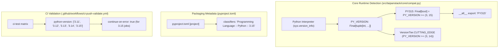

# Python 3.15 Integration and Runtime Compatibility

* **Author:** TaipanStack Team
* **Status:** Approved
* **Date:** 2026-10-27

--------------------------------------------------------------------------------

## Overview

TaipanStack provides core runtime utilities, strict typing primitives, and security tools for Python applications. This feature establishes official compatibility, static version detection, and continuous integration validation for Python 3.15 (released October 9, 2026 under PEP 790).

By extending the runtime compatibility module (`src/taipanstack/core/compat.py`), packaging metadata (`pyproject.toml`), and CI test matrix (`.github/workflows/ci-push-validate.yml`), this design guarantees that applications built with TaipanStack can target and execute under Python 3.15 with strict type safety, verified builds, and stable performance optimizations.

## The Problem

Currently, TaipanStack's compatibility detection constants cap runtime version flags at Python 3.14 (`PY314`). Running applications under Python 3.15 introduces the following gaps:
1. **Missing Runtime Version Constant**: The system does not expose a static boolean constant `PY315` in `taipanstack.core.compat`, preventing downstream libraries and applications from deterministically checking if the host interpreter is Python 3.15.
2. **Package Metadata Drift**: The `pyproject.toml` package classifiers only declare support up to Python 3.14, signalling false incompatibility on PyPI despite permissive dependency constraints (`>=3.11,<4.0`).
3. **Missing Automated CI Enforcement**: Continuous integration suites do not validate the codebase against Python 3.15 runners, leaving open the risk of regressions or unexpected C-extension incompatibilities.

## Goals

* **Deterministic Runtime Detection**: Introduce `PY315: Final[bool] = PY_VERSION >= (3, 15)` in `src/taipanstack/core/compat.py` with minimal runtime overhead and export via `__all__`.
* **Preserve Version Tier Mapping**: Leverage existing `VersionTier.CUTTING_EDGE` categorization natively covering Python 3.14+ without modifying existing branching logic.
* **Package Metadata Alignment**: Append `"Programming Language :: Python :: 3.15"` to the `classifiers` array in `pyproject.toml`.
* **Isolated CI Validation**: Add Python 3.15 to `.github/workflows/ci-push-validate.yml` with failure isolation (`continue-on-error: true`) until upstream pre-compiled C-extension binary wheels stabilize across all operating systems.
* **100% Test Coverage & Strict Typing**: Maintain 100% branch and line coverage for all new constants and compatibility checks under `mypy --strict`.

## Non-Goals

* **Dropping Python 3.11 or 3.12**: Strict backward compatibility across Python 3.11, 3.12, 3.13, and 3.14 is preserved.
* **Speculative Feature Flags**: Built-in Python 3.15 collection types (such as PEP 814 `frozendict`) are not wrapped in speculative `PythonFeatures` dataclass fields since TaipanStack implements zero custom serialization logic for them.
* **Forking Upstream C-Extensions**: Third-party libraries (`orjson`, `uvloop`, `argon2-cffi`, `msgpack`) are consumed directly from upstream PyPI wheels.
* **Architectural Refactoring**: No changes to existing layer boundaries or public APIs outside `taipanstack.core.compat`.

## Critical User Journeys (CUJs)

### CUJ 1: Developer imports and detects Python 3.15 runtime features
* **Given**: A Python application running under a Python 3.15 environment importing `taipanstack`.
* **When**: The developer evaluates `PY315` and executes `get_features()`.
* **Then**: `PY315` evaluates to `True`, `features.version` reports `(3, 15, x)`, and `features.tier` returns `VersionTier.CUTTING_EDGE`.

### CUJ 2: CI validation of TaipanStack on Python 3.15
* **Given**: A pull request submitted to the TaipanStack repository.
* **When**: GitHub Actions runs `ci-push-validate.yml`.
* **Then**: The test matrix executes the full test suite against Python 3.15 runners under failure-isolated configuration and reports execution results.

--------------------------------------------------------------------------------

## Technical Plan (Architecture)

### Architectural Overview & Compatibility Topology

The integration touches three distinct layers: Core Runtime Detection, Packaging Metadata, and CI Pipeline Validation.



### Component Changes

#### 1. Core Compatibility Module (`src/taipanstack/core/compat.py`)
* **Version Constant**:
  Define `PY315: Final[bool] = PY_VERSION >= (3, 15)`.
* **Export Expansion**:
  Add `"PY315"` to module export list `__all__`.
* **Version Tier Categorization (`_get_version_tier`)**:
  Zero code changes required. `VersionTier.CUTTING_EDGE` is defined for `PY_VERSION >= (3, 14)`, so `PY314` automatically evaluates to `True` for Python 3.15 interpreters.

#### 2. Packaging Specification (`pyproject.toml`)
* Append classifier `"Programming Language :: Python :: 3.15"` to the `classifiers` list under `[project]`.
* Maintain `requires-python = ">=3.11,<4.0"`.

#### 3. Continuous Integration Matrix (`.github/workflows/ci-push-validate.yml`)
* Add `"3.15"` to `strategy.matrix.python-version` list in `ci-test` job with `continue-on-error: true` (or scoped to `ubuntu-latest`) to isolate against missing upstream binary wheels.

#### 4. Automated Regression Tests (`tests/test_compat_standard_expected.py`)
* Add unit test `test_compat_standard_compat_py315_constant` validating that `PY315 == (sys.version_info >= (3, 15))`.
* Add assertion verifying `"PY315"` presence in `taipanstack.core.compat.__all__`.
* Add simulated mock tests patching `taipanstack.core.compat.PY315` and `taipanstack.core.compat.PY_VERSION` with `get_features(force_refresh=True)` to achieve 100% branch and line coverage on pre-3.15 test runners.

## Open Questions

* **CI Runner Binary Availability**: GitHub Actions `actions/setup-python` runner availability for Python 3.15 will be tracked. The use of `continue-on-error: true` ensures that any runner delays or compilation requirements do not block main development branches.

--------------------------------------------------------------------------------

## Alternatives Considered

### Alternative A: Introducing a New VersionTier (e.g., `NEXT_GEN = "next_gen"`)
* **Pros**: Explicitly distinguishes 3.14 and 3.15 runtime tiers under distinct string enum names.
* **Cons**: Breaks consumers and client logic matching against existing enum values (`VersionTier.CUTTING_EDGE`).
* **Reason for Rejection**: Unnecessary breaking change. Python 3.14 and 3.15 share equivalent JIT characteristics. Treating 3.14+ under `CUTTING_EDGE` preserves backward compatibility.

### Alternative B: Speculative Detection of Builtin `frozendict` in `PythonFeatures`
* **Pros**: Exposes a boolean flag for PEP 814 collection support.
* **Cons**: TaipanStack has no internal serializer or consumer for `frozendict`. Built-in collections can be checked natively via `hasattr(builtins, "frozendict")`.
* **Reason for Rejection**: Violates YAGNI. Introducing public contract fields without internal consumption creates maintenance overhead and schema drift.

### Alternative C: Restricting Minimum Python Version to 3.12+
* **Pros**: Reduces matrix testing overhead and deprecates legacy 3.11 compatibility code paths.
* **Cons**: Breaks active production deployments running on Python 3.11 LTS.
* **Reason for Rejection**: Violates TaipanStack's stability pillar. Compatibility with 3.11 must be preserved until its official end-of-life.

### Alternative D: Dynamic Runtime Reflection without Static Constants
* **Pros**: Automatically adapts to Python 3.16 and beyond without requiring explicit code updates.
* **Cons**: Defeats static type analysis with `mypy --strict`, introduces reflection latency, and prevents dead-code elimination.
* **Reason for Rejection**: Violates the project constitution requiring strict static typing and explicit Look-Before-You-Leap guarantees.

--------------------------------------------------------------------------------

## Detailed Implementation Plan

### Phase 1: Core Runtime Detection (`src/taipanstack/core/compat.py`)
1. In `src/taipanstack/core/compat.py`:
   - Declare `PY315: Final[bool] = PY_VERSION >= (3, 15)` immediately following `PY314`.
   - Add `"PY315"` to the `__all__` sequence.
   - Leave `_get_version_tier()` unchanged, as `if PY314:` automatically captures Python 3.15 and assigns `VersionTier.CUTTING_EDGE`.
2. **Checkpoint 1**:
   - Run `poetry run ruff check src/taipanstack/core/compat.py`
   - Run `poetry run mypy src/taipanstack/core/compat.py --strict`
   - Ensure clean exit with zero errors.

### Phase 2: Test Suite Expansion & Mock Verification (`tests/test_compat_standard_expected.py`)
1. In `tests/test_compat_standard_expected.py` under class `TestVersionConstants`:
   - Add `test_compat_standard_compat_py315_constant(self) -> None:` verifying:
     ```python
     expected = sys.version_info >= (3, 15)
     assert expected == PY315
     ```
   - Add assertion verifying `"PY315" in __all__`.
2. Under class `TestPythonFeatures`:
   - Add mock verification test exercising Python 3.15 detection on pre-3.15 interpreters:
     ```python
     def test_compat_standard_compat_features_mock_315(self) -> None:
         """Test features reporting when simulated on Python 3.15."""
         with patch("taipanstack.core.compat.PY315", True), \
              patch("taipanstack.core.compat.PY_VERSION", (3, 15, 0)):
             features = get_features(force_refresh=True)
             assert features.version == (3, 15, 0)
             assert features.tier == VersionTier.CUTTING_EDGE
     ```
3. Verify existing version tier tests (`test_compat_standard_compat_features_tier_stable`, `tier_enhanced`, `tier_modern`) continue to pass without modification.
4. **Checkpoint 2**:
   - Run `poetry run pytest tests/test_compat_standard_expected.py -v --cov=taipanstack.core.compat --cov-report=term-missing`
   - Confirm 100% branch and statement coverage on `src/taipanstack/core/compat.py`.

### Phase 3: Package Metadata & Documentation (`pyproject.toml`, `README.md`)
1. In `pyproject.toml`:
   - Append `"Programming Language :: Python :: 3.15"` to the `classifiers` array under `[project]`.
2. In `README.md`:
   - Update the Python version shield badge to include `3.15` (e.g., `Python-3.11 | 3.12 | 3.13 | 3.14 | 3.15-blue.svg`).
3. **Checkpoint 3**:
   - Run `poetry check`
   - Run `git diff pyproject.toml README.md` to confirm clean formatting.

### Phase 4: CI Workflow Configuration & Pipeline Validation (`.github/workflows/ci-push-validate.yml`)
1. In `.github/workflows/ci-push-validate.yml`:
   - Add `"3.15"` to `strategy.matrix.python-version` under the `ci-test` job.
   - Configure failure isolation for the 3.15 runner jobs (`continue-on-error: true`) to safeguard PR pipelines while upstream C-extension wheels stabilize.
2. **Checkpoint 4**:
   - Validate YAML syntax and lint workflow file.

### Phase 5: Verification & Quality Gate
1. Execute full local verification:
   - `poetry run ruff check src/ tests/ taipanstack_bootstrapper.py`
   - `poetry run ruff format --check src/ tests/ taipanstack_bootstrapper.py`
   - `poetry run mypy src/ --strict`
   - `poetry run pytest --cov=taipanstack.core.compat --cov-report=term-missing`
   - `make all`
2. Validate documentation build:
   - `NO_MKDOCS_2_WARNING=1 poetry run mkdocs build --strict`
3. **Checkpoint 5**:
   - All quality gates pass with zero warnings, zero errors, and 100% test coverage.
